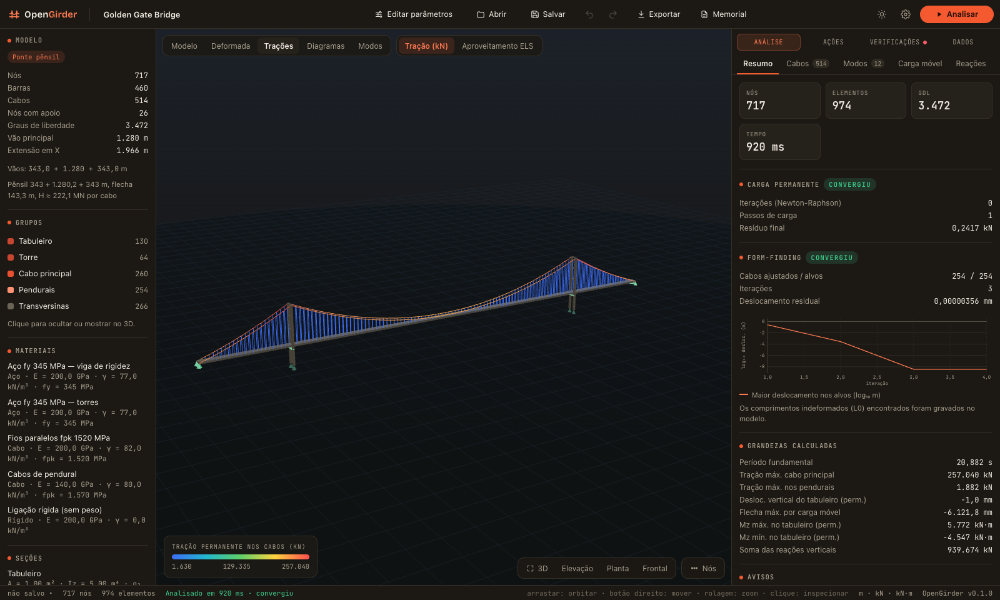
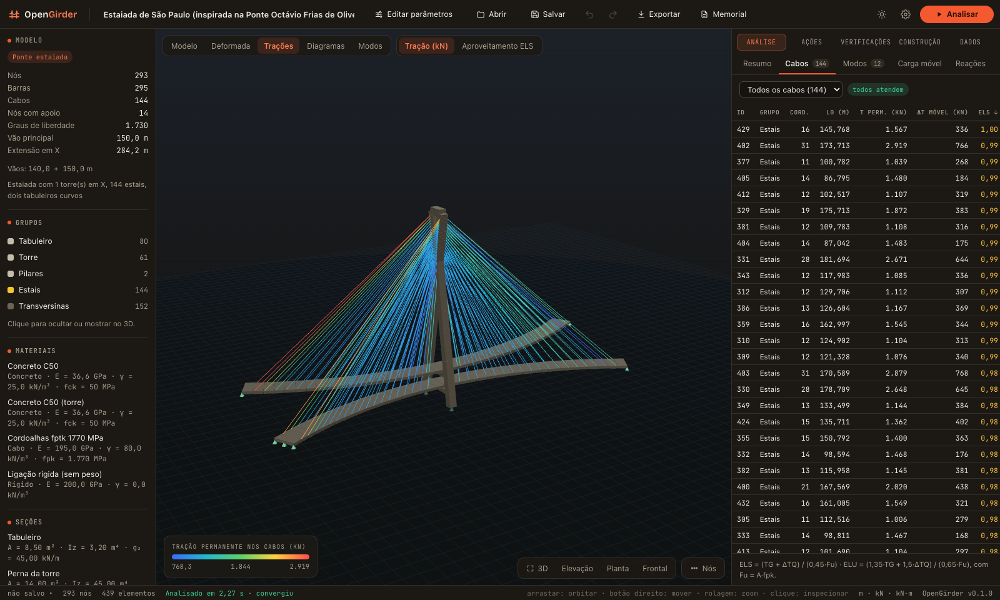
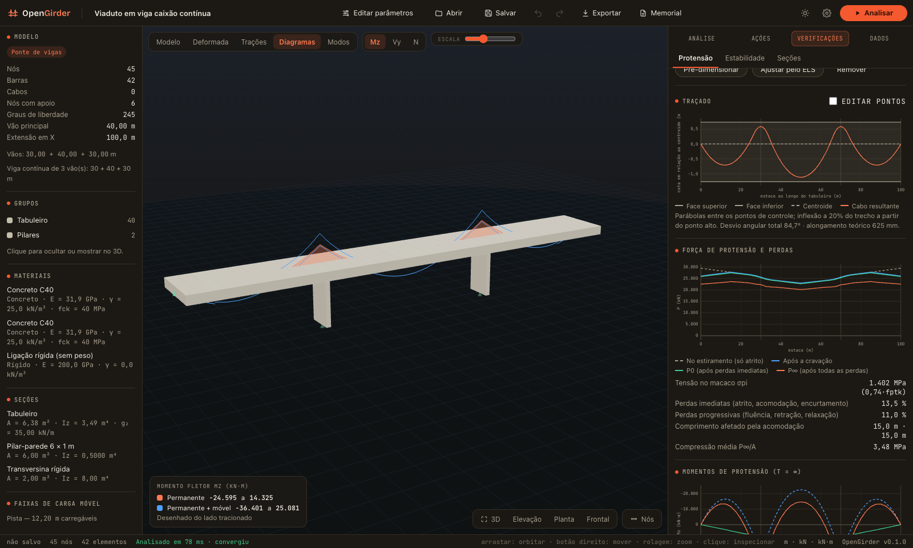
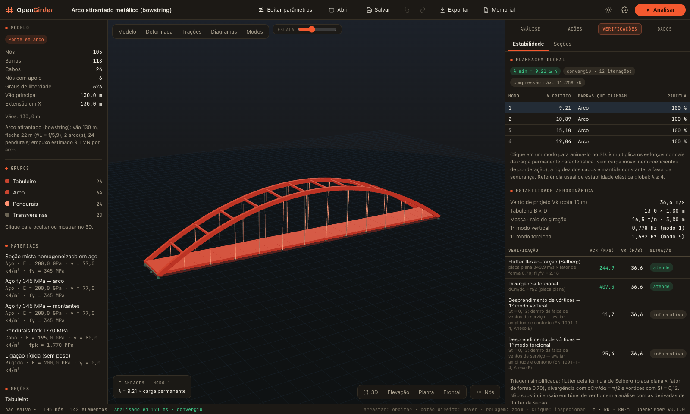
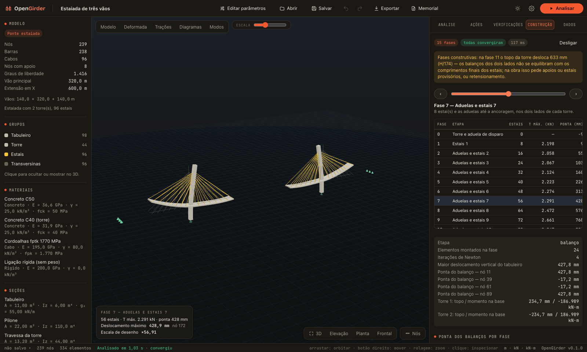
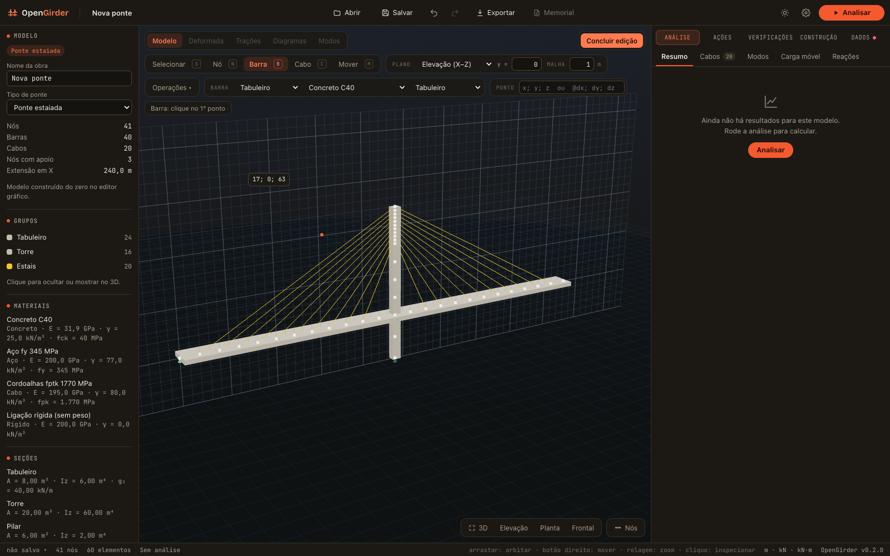
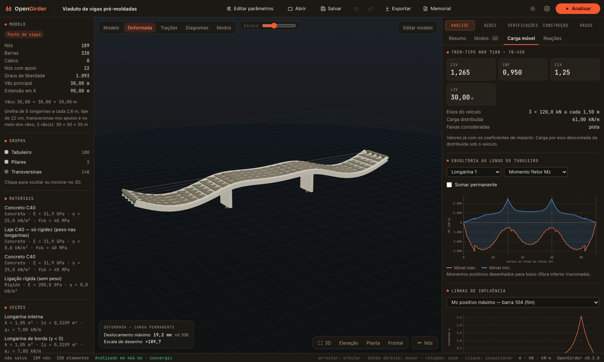
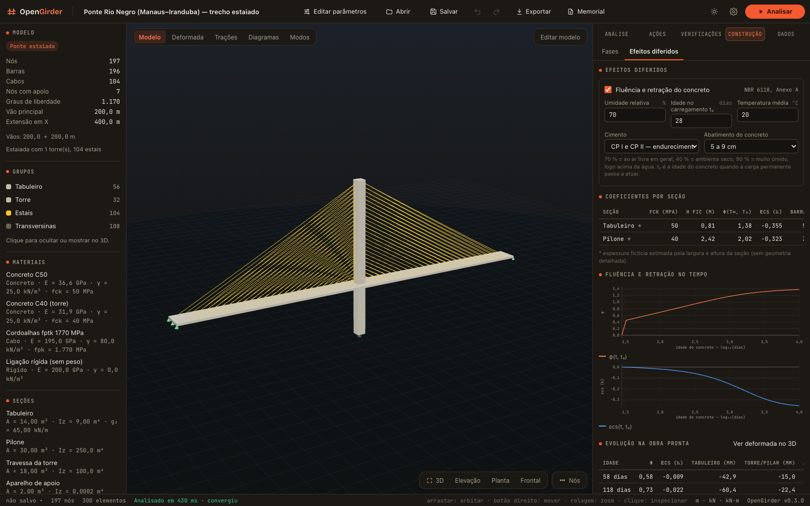

# OpenGirder

**Análise e verificação de pontes — vigas, arcos, estaiadas e pênseis — com as normas brasileiras. Gratuito e de código aberto (MIT).**

**[▶ Abrir no navegador](https://candidoalfilho.github.io/opengirder/)** · [Baixar instaladores](https://github.com/candidoalfilho/opengirder/releases/latest) (Windows, macOS, Linux) · [Validação](VALIDATION.md) · [Roadmap](ROADMAP.md)



O OpenGirder modela e calcula pontes de verdade no seu computador, sem instalar nada: uma ponte pênsil de 1 280 m de vão (Golden Gate) roda em cerca de 1 segundo no navegador; uma estaiada com mastro em X, dois tabuleiros curvos e 144 estais (inspirada na Ponte Octávio Frias de Oliveira, em São Paulo), em cerca de 2 segundos.

É o irmão do [HyperFrame](https://github.com/candidoalfilho/hyperframe) (edifícios): mesma pilha, mesmo princípio — motor de cálculo próprio, sem dependências, auditável linha a linha.

## O que ele faz

### Análise

| | |
|---|---|
| **Cabos** | Elemento de catenária elástica exata (Irvine) para estais, cabos principais e pendurais — flecha, afrouxamento e rigidez geométrica saem da formulação, sem módulo de Ernst |
| **Não linearidade geométrica** | Barras corrotacionais com rotação finita exata e rigidez geométrica (P-Δ e P-δ); Newton-Raphson com busca linear em energia |
| **Form-finding** | Comprimento indeformado de cada estai e pendural para o tabuleiro ficar no greide e a torre no prumo; forma do cabo de ponte pênsil por catenária trecho a trecho |
| **Modal** | Iteração por subespaço sobre a rigidez tangente do estado de carga permanente; massas efetivas e classificação do modo |
| **Flambagem** | Fator de carga crítico e modos de flambagem no estado de carga permanente (torres, arcos, tabuleiros comprimidos) |
| **Fases construtivas** | Análise regressiva de estaiadas em balanços sucessivos: trações de instalação de cada estai, cotas de montagem e esforços na torre fase a fase |
| **Efeitos diferidos** | Fluência e retração do concreto pelo Anexo A da NBR 6118 (módulo efetivo ajustado pela idade): flechas no tempo, redistribuição de esforços, variação de tração dos estais, na obra pronta e ao longo das fases |

### Ações e combinações

| | |
|---|---|
| **Carga móvel NBR 7188** | TB-450, TB-240 e multidão em passarelas, por linhas de influência de todas as respostas; CIV, CNF e CIA; envoltórias de esforços, trações, flechas e reações |
| **Temperatura** | Variação uniforme, gradiente no tabuleiro e diferencial entre cabos e estrutura |
| **Vento NBR 6123** | Pressão dinâmica com S1, S2 e S3 por cota; arrasto em tabuleiro, torres e cabos, com e sem tráfego |
| **Frenagem e aceleração** | NBR 7188, item 5.2.1 |
| **Sismo NBR 15421** | Análise espectral com combinação CQC sobre os modos calculados |
| **Protensão** | Cabos pós-tracionados: traçado parabólico, perdas por atrito, acomodação, encurtamento, fluência, retração e relaxação; cargas equivalentes, isostático e hiperestático |
| **Combinações NBR 8681** | ELU normal e excepcional, ELS rara, frequente e quase permanente, com envoltórias por esforço |

### Verificações

| | |
|---|---|
| **Estais, cabos e pendurais** | ELS (0,45·Fu), ELU (0,65·Fu), variação de tensão para fadiga; dimensionamento automático do número de cordoalhas |
| **Concreto — NBR 6118** | Flexão composta (armadura necessária), cortante, torção e interação; flexo-compressão de torres, pilares e arcos |
| **Concreto protendido** | Tensões no ato da protensão, descompressão e formação de fissuras (protensão limitada e completa); pré-dimensionamento do cabo |
| **Aço — NBR 8800** | Tensões normais e de cisalhamento elásticas |
| **Aerodinâmica** | Triagem de flutter (Selberg), divergência torcional e desprendimento de vórtices |
| **Passarelas** | Frequências na faixa crítica do passo |

### Modelagem e saída

- **Editor gráfico — construa a ponte do zero**: modelo em branco, nós, barras e cabos desenhados direto no 3D com captura em malha e em nós, plano de trabalho em elevação, planta ou transversal, coordenadas digitadas, seleção por janela, mover, copiar, espelhar, girar, dividir barras, gerar a linha do tabuleiro e **gerar os estais** entre torre e tabuleiro (leque, semi-leque ou harpa).
- **Biblioteca** de materiais (concretos C25 a C90, aços estruturais, cordoalhas) e seções prontas; **pistas** de carga móvel automáticas; **diagnóstico** do modelo com correção em um clique.
- **Tabuleiro em grelha** para pontes de vigas múltiplas: longarinas em seção T, faixas de laje e transversinas, com os esforços de cada longarina e a repartição transversal da carga móvel pelo próprio modelo.
- **Assistentes paramétricos** para ponte de vigas (contínua ou em pórtico, protendida), em arco (inferior, superior, atirantado, de tabuleiro intermediário), estaiada (1 ou 2 torres, harpa/leque/semi-leque, 1 ou 2 planos, tabuleiro curvo, torre em X, tabuleiros gêmeos) e pênsil.
- **Seções por geometria**: caixão uni ou multicelular, vigas T, laje, mistas aço-concreto e seções de torre, com propriedades calculadas (inclusive torção de Bredt).
- **Editor de dados** em tabelas (nós, barras, cabos, seções, materiais, cargas), com desfazer e refazer.
- **Visualização 3D**: deformada, trações, diagramas com envoltórias, modos de vibração e de flambagem animados, fases construtivas.
- **Memorial de cálculo** pronto para imprimir em PDF, e exportação em DXF, CSV, JSON e PNG.

Modelos prontos: **Golden Gate**, **Estaiada de São Paulo**, **Ponte Rio Negro**, estaiada de três vãos, arco atirantado metálico, arco de concreto de 290 m, ponte extradorso, passarela estaiada, viaduto de vigas múltiplas em grelha e viaduto protendido em viga caixão.

| | |
|---|---|
|  |  |
|  |  |

Uma estaiada construída do zero no editor gráfico — tabuleiro, torre, apoios e 20 estais gerados — e calculada em 0,14 s:



| | |
|---|---|
|  |  |

## Rodar

No navegador, sem instalar: **https://candidoalfilho.github.io/opengirder/**

Do código:

```bash
npm install
npm run dev          # abre em http://localhost:5193
npm test             # testes do motor (soluções analíticas + modelos de referência)
npm run tauri dev    # aplicativo desktop (precisa do Rust)
```

Os instaladores de Windows, macOS e Linux são gerados pelo GitHub Actions a cada versão (`.github/workflows/release.yml`). No macOS o aplicativo não é assinado pela Apple: na primeira vez, clique com o botão direito e escolha **Abrir**.

O motor também roda sozinho, sem interface:

```ts
import { PRESETS, generateModel, analyzeBridge } from '@opengirder/engine'

const model = generateModel(PRESETS.find((p) => p.id === 'golden-gate')!.template)
const r = analyzeBridge(model, { modal: { modes: 12 }, sizeCables: true })

r.modal!.modes[0].period            // 20,88 s — 1º modo transversal
r.checks.cables[0].TG               // tração permanente no cabo (kN)
r.combos!.frames[0].elu.Mz          // envoltória de momento no ELU
r.buckling!.modes[0].factor         // fator de carga crítico de flambagem
```

`npm run presets -w @opengirder/engine` imprime o resumo dos modelos de referência; `npm run sweep -w @opengirder/engine` roda 30 variações de gabarito.

## Estrutura

```
packages/engine    motor de cálculo — TypeScript puro, zero dependências, zero DOM
  src/analysis       skyline LDLᵀ, RCM, barra corrotacional, catenária, Newton, modal, flambagem
  src/formfinding    form-finding dos cabos
  src/loads          NBR 7188, temperatura, NBR 6123, frenagem, NBR 15421
  src/combos         combinações NBR 8681
  src/prestress      traçado, perdas, cargas equivalentes e verificações de protensão
  src/sections       geometria e propriedades de seções
  src/checks         NBR 6118, NBR 8800, aerodinâmica, passarelas
  src/stages         fases construtivas (análise regressiva)
  src/templates      geradores paramétricos e modelos de referência
  test               soluções analíticas e regressão dos modelos
apps/desktop       interface — Tauri 2 + React 19 + three.js; a análise roda em Web Worker
```

Unidades internas: m, kN, kPa. Eixos globais: X ao longo da ponte, Y transversal, Z para cima.

## Validação e limites

Cada peça do motor é conferida contra solução fechada, e os modelos de referência contra valores publicados — veja [VALIDATION.md](VALIDATION.md). Para a Golden Gate: tração no cabo principal de 224 a 257 MN (publicado: 213 a 253 MN); 1º modo transversal em 20,88 s (referência 20,50 s); 1º vertical simétrico em 7,86 s (referência 7,81 s). O 1º modo torcional não fecha (6,68 s contra 8,98 s), porque o tabuleiro é uma barra única.

**O que ele ainda não faz** (ver [ROADMAP.md](ROADMAP.md)):

- Análise progressiva completa no tempo: a fluência e a retração entram na obra pronta e como parcela por fase construtiva somada ao estado elástico, sem retensionamento de estais nem balanços sucessivos de vigas.
- Grelha em estaiadas e pênseis: o tabuleiro dessas pontes continua em espinha (por isso o 1º modo torcional da Golden Gate depende da rigidez à torção estimada).
- Casca: o tabuleiro é uma espinha de barras ou, em pontes de vigas múltiplas, uma grelha de longarinas, laje e transversinas. Não há elementos de placa: a flexão local da laje sob a roda e o detalhamento da laje ficam de fora, e pontes estaiadas e pênseis continuam com o tabuleiro em espinha.
- Não linearidade física, análise no tempo, interação solo-estrutura, fadiga detalhada e ancoragens.
- As ações variáveis e a carga móvel são linearizadas em torno do estado de carga permanente.
- A triagem aerodinâmica não substitui ensaio em túnel de vento.
- Os coeficientes de norma foram conferidos em fontes públicas (tabela e fontes em [docs/normas.md](docs/normas.md)), não no texto oficial da ABNT; as edições mais recentes (NBR 7188:2024, NBR 8681:2025, NBR 15421:2023) ainda não foram incorporadas.

As propriedades de seção dos modelos de obras reais são **estimativas** a partir de dados públicos: os modelos servem para demonstrar e validar o motor, não para reavaliar aquelas obras. Como em qualquer programa de análise estrutural, o resultado é responsabilidade do engenheiro que o usa.

## Licença

MIT — use, modifique e distribua à vontade.
